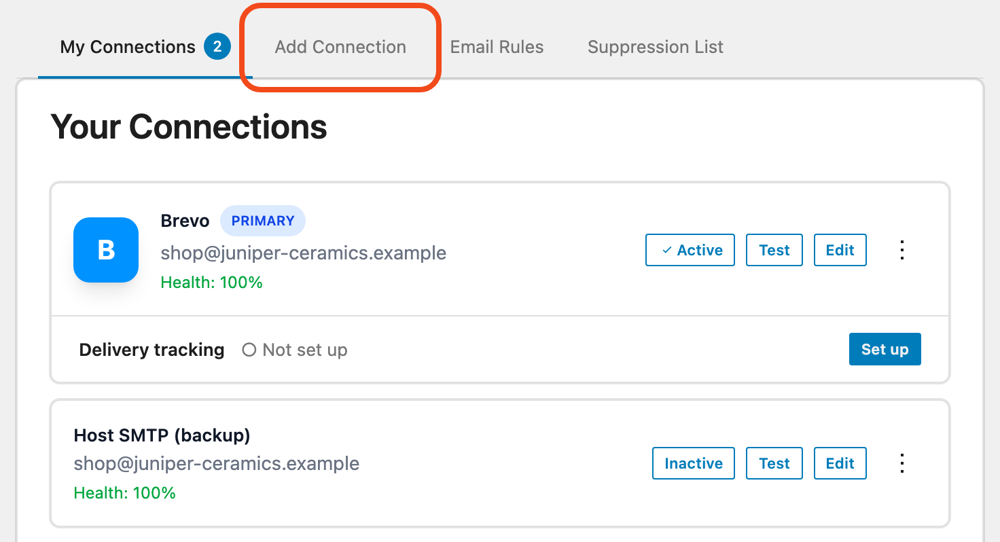
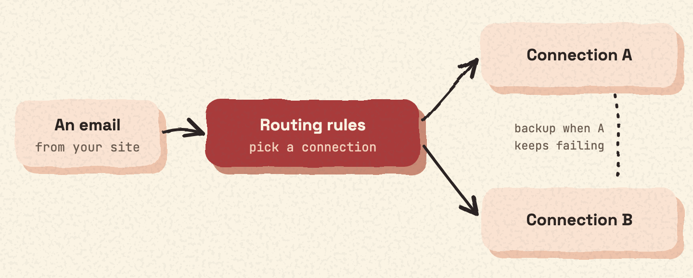

A connection is the email service your site sends through. Impressive Mail works with 27 email services and with any other SMTP server.

## Add one

1. Go to **Mail Ops › Connections**.
2. Add a new connection: pick a provider and enter your details.
3. Test the connection, or [send a test email](test.md).

## API or SMTP

Many providers can send through their HTTP API when you enter an API key. Without a key, they send through SMTP.

Gmail and Microsoft 365 connect through SMTP.

### Gmail and Google Workspace

Gmail connects through SMTP (`smtp.gmail.com`). You need your Gmail address and an App Password. You create the App Password in your Google Account, under Security and 2-Step Verification.

## More than one connection

You can add several connections. They help in two ways:

- [Smart Routing rules](routing.md) decide which connection sends which email.
- Other connections act as backups when one connection keeps failing. See [Alerts and failover](failover.md).

## How your login details are stored

Passwords and API keys are stored encrypted in your database. See [Security](security.md).

For the list of services and what is sent to each one, see [The 27 email services](services.md).
