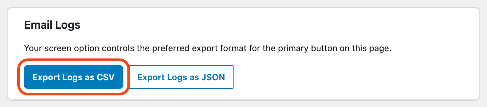

## Export

Go to **Mail Ops › Export** to export your email logs to a CSV file. You can open the file in any spreadsheet app.

The log stores the recipients, From address, subject, status, error message, headers and attachment file names. It does not store the email body. See [What the log stores](log.md#what-the-log-stores).

## Keep the file safe

Your email log holds personal data, such as the recipients' email addresses. Store the exported file with care, and delete it when you no longer need it.
