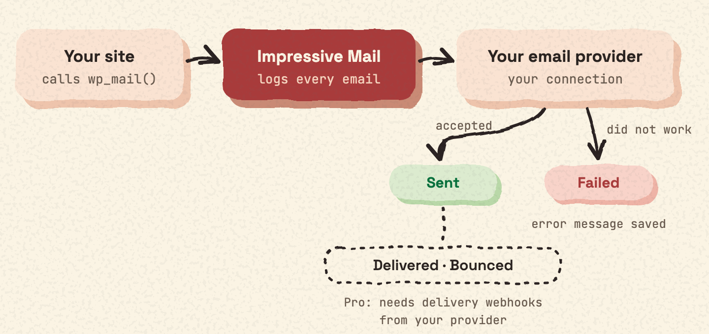
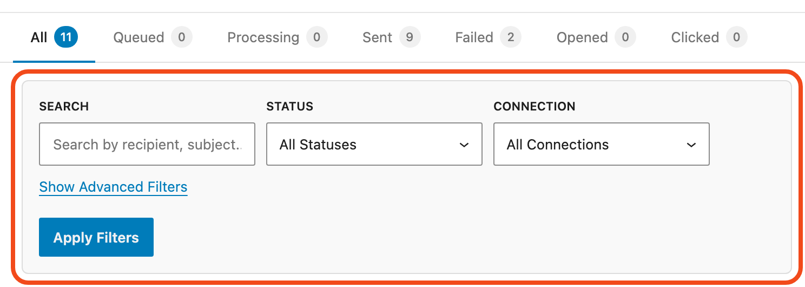
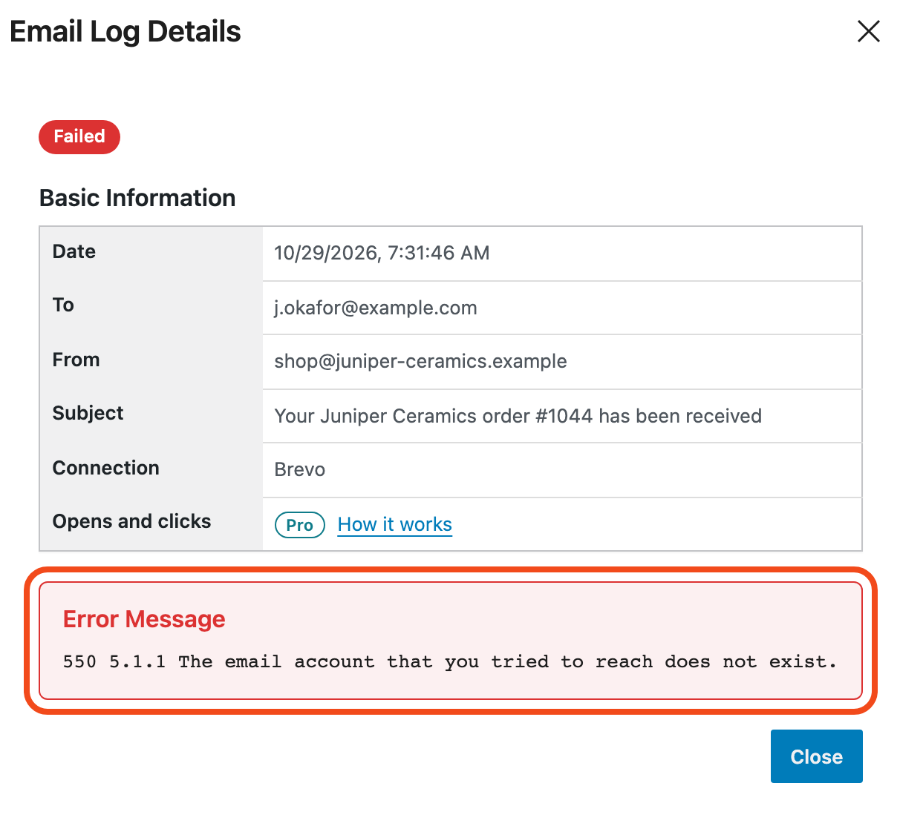
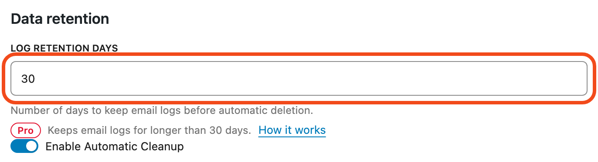

Every email sent through `wp_mail()` is logged with its status. Find the log in **Mail Ops › Emails**.

## Statuses

| Status | What it means |
| --- | --- |
| Sent | Your provider accepted the email. |
| Failed | Sending did not work. The log shows the error message. |

Delivered and bounced statuses need delivery webhooks from your provider. They are part of Impressive Mail Pro.

## Find an email

- Search by subject, recipient or sender.
- Filter by date, connection and status.

## Open an email

Open any email to see its recipients, headers, attachment names and error message.

## What the log stores

For each email, the log stores:

- the recipients (To)
- the From address
- the subject
- the status (sent or failed) and the date
- the error message, if sending failed
- the email headers (these can include CC and BCC addresses)
- the file names and paths of attachments (not the files)

It does not store the email body.

## How long logs are kept

You choose a number between 1 and 30 days in **Mail Ops › Settings**. The default is 30 days. Logs older than that are deleted automatically once a day.

If you turn off automatic deletion, logs are kept until you delete them. You can delete single log entries in **Mail Ops › Emails**.

Impressive Mail Pro can keep logs longer.

To keep a copy of your logs, see [Export your logs](export.md).
