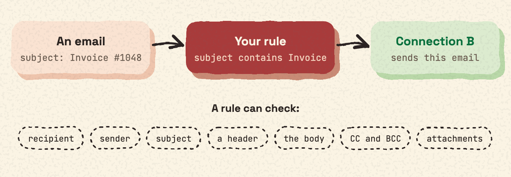
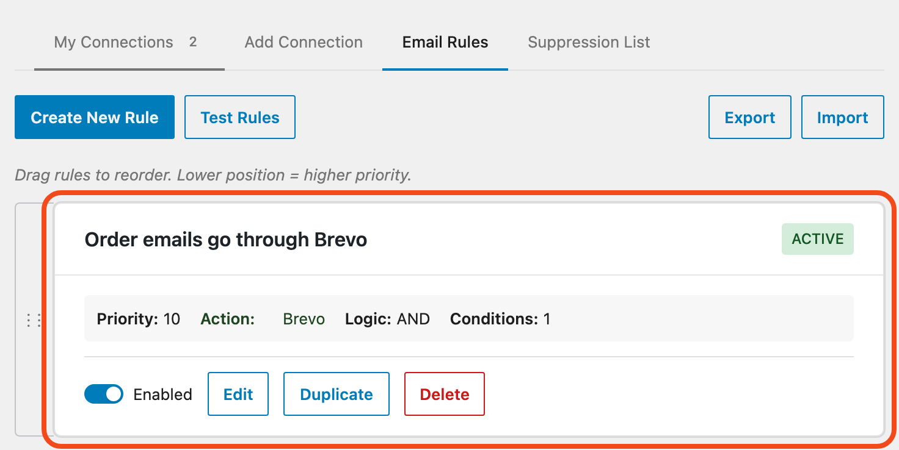

Smart Routing rules decide which connection sends which email. For example, a rule can send every email whose subject contains "Invoice" through one connection.

## Where to find the rules

Go to **Mail Ops › Connections** and open the **Email Rules** tab.

A rule picks one of your connections, so add them first. See [Add a connection](connections.md).

## What a rule can check

- the recipient email or domain
- the sender email
- the subject
- a header
- the email body
- CC and BCC addresses
- attachments: has attachments, count, type or name

## How a condition compares

Each condition can use one of these:

- equals
- does not equal
- contains
- does not contain
- starts with
- ends with
- matches regex
- is in list

Your other connections still act as backups when one keeps failing. See [Alerts and failover](failover.md).
