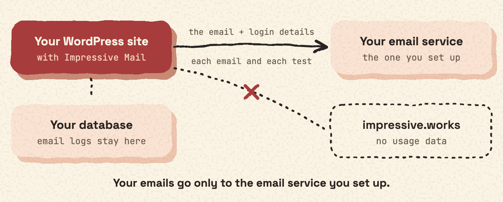

## Passwords and API keys

Passwords and API keys are encrypted in the database with AES-256-CTR. The key comes from your WordPress security keys, `AUTH_KEY` and `SECURE_AUTH_KEY`.

## Who can change the settings

Only administrators can see or change the settings. Admin actions are protected by WordPress nonces.

## What stays on your site

- Your email logs stay in your WordPress database. See [What the log stores](log.md#what-the-log-stores).
- The plugin does not send usage data anywhere.
- Your emails go only to the email service you set up. See [The 27 email services](services.md).

