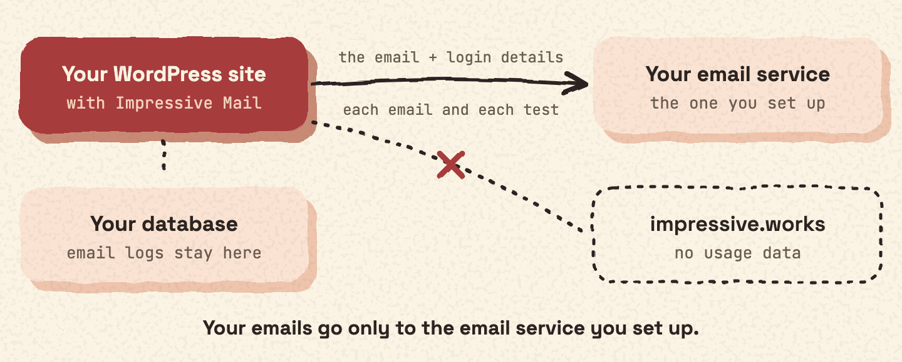

Impressive Mail sends your site's email through the email service you choose. It only contacts a service after an administrator sets up a connection to it. Nothing is sent to Impressive.

## What is sent, and when

For every connection:

- **What is sent:** the full email message (recipients, From address, subject, body, headers and attachments) and the login details for that service (username and password, API key, or access token).
- **When:** every time your site sends an email through that connection, every time you send a test email, and when you test the connection.

The plugin does not send usage data (telemetry) anywhere.

## The services

Many providers can send through their HTTP API (API) when you enter an API key. Without a key, they send through SMTP.

| Service | Hosts the plugin contacts | Terms and privacy |
| --- | --- | --- |
| Gmail / Google Workspace (Google) | `smtp.gmail.com` (SMTP) | [Terms](https://policies.google.com/terms), [Privacy](https://policies.google.com/privacy) |
| Microsoft 365 / Outlook.com (Microsoft) | `smtp.office365.com` (SMTP) | [Privacy](https://privacy.microsoft.com/privacystatement) |
| Microsoft Graph API (Microsoft) | `login.microsoftonline.com` (to get an access token with your client ID and secret), `graph.microsoft.com` (to send) | [Privacy](https://privacy.microsoft.com/privacystatement) |
| Azure Communication Services (Microsoft) | The resource endpoint you enter (`*.communication.azure.com`) | [Privacy](https://privacy.microsoft.com/privacystatement) |
| Amazon SES (Amazon Web Services) | `email.REGION.amazonaws.com` (API) or `email-smtp.REGION.amazonaws.com` (SMTP). REGION is the AWS region you choose. | [Terms](https://aws.amazon.com/service-terms/), [Privacy](https://aws.amazon.com/privacy/) |
| SendGrid (Twilio) | `api.sendgrid.com` or `api.eu.sendgrid.com` (API), `smtp.sendgrid.net` (SMTP) | [Terms](https://www.twilio.com/en-us/legal/tos), [Privacy](https://www.twilio.com/en-us/legal/privacy) |
| Mailgun | `api.mailgun.net` or `api.eu.mailgun.net` (API), `smtp.mailgun.org` (SMTP) | On mailgun.com |
| Postmark | `api.postmarkapp.com` (API), `smtp.postmarkapp.com` (SMTP) | [Terms](https://postmarkapp.com/terms-of-service), [Privacy](https://postmarkapp.com/privacy-policy) |
| Brevo (Sendinblue) | `api.brevo.com` (API), `smtp-relay.brevo.com` (SMTP) | [Terms](https://www.brevo.com/legal/termsofuse/), [Privacy](https://www.brevo.com/legal/privacypolicy/) |
| Mailjet | `api.mailjet.com` (API), `in-v3.mailjet.com` (SMTP) | On mailjet.com |
| MailerSend | `api.mailersend.com` (API), `smtp.mailersend.net` (SMTP) | [Terms](https://www.mailersend.com/legal/terms-of-use), [Privacy](https://www.mailersend.com/legal/privacy-policy) |
| Mandrill / Mailchimp Transactional (Intuit) | `mandrillapp.com` (API), `smtp.mandrillapp.com` (SMTP) | [Privacy](https://www.intuit.com/privacy/statement/) |
| Resend | `api.resend.com` (API), `smtp.resend.com` (SMTP) | [Terms](https://resend.com/legal/terms-of-service), [Privacy](https://resend.com/legal/privacy-policy) |
| Mailtrap | `send.api.mailtrap.io` or `sandbox.api.mailtrap.io` (API), `live.smtp.mailtrap.io` (SMTP) | [Privacy](https://mailtrap.io/privacy/) |
| MailPace | `app.mailpace.com` (API), `smtp.mailpace.com` (SMTP) | [Privacy](https://mailpace.com/privacy) |
| Mailomat | `api.mailomat.swiss` (API), `smtp.mailomat.swiss` (SMTP) | On mailomat.swiss |
| Scaleway Transactional Email | `api.scaleway.com` (API), `smtp.tem.scw.cloud` (SMTP) | On scaleway.com |
| AhaSend | `send.ahasend.com` (API), `smtp.ahasend.com` (SMTP) | On ahasend.com |
| Sweego | `api.sweego.io` (API), `smtp.sweego.io` (SMTP) | [Privacy](https://www.sweego.io/privacy-policy) |
| Infobip | The base URL you enter, for example `xxxxx.api.infobip.com` (API), `smtp-api.infobip.com` (SMTP) | [Privacy](https://www.infobip.com/policies/privacy-notice) |
| Postal | The Postal server URL you enter. Postal is self-hosted software, so the data goes to the server you or your provider run. | — |
| SMTP2GO | `api.smtp2go.com` (API), `mail.smtp2go.com` (SMTP) | [Privacy](https://www.smtp2go.com/privacy/) |
| Elastic Email | `api.elasticemail.com` (API), `smtp.elasticemail.com` (SMTP) | [Privacy](https://elasticemail.com/resources/usage-policies/privacy-policy) |
| Pepipost (Netcore) | `api.pepipost.com` (API), `smtp.pepipost.com` (SMTP) | [Privacy](https://netcore.ai/privacy-policy/) |
| Zoho Mail (Zoho) | `mail.zoho.com` (API), `accounts.zoho.com` (to refresh the access token, using your client ID, client secret and refresh token), `smtp.zoho.com` (SMTP) | [Terms](https://www.zoho.com/terms.html), [Privacy](https://www.zoho.com/privacy.html) |
| SparkPost | `smtp.sparkpostmail.com` (SMTP) | On its website |
| SMTP.com | `smtp.smtp.com` (SMTP) | On smtp.com |

## Any other SMTP server

You can also use any other SMTP server. The plugin contacts the SMTP server you enter, and the data goes to that server. See the terms of whoever runs it.
