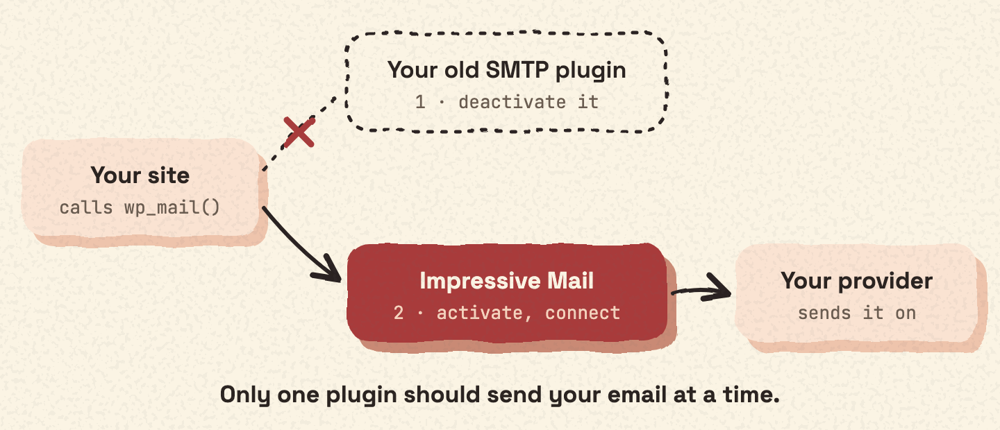

Only one plugin should send your site's email at a time. So you turn the old plugin off before Impressive Mail takes over.

## Steps

1. Deactivate your old SMTP plugin in **Plugins**.
2. [Install Impressive Mail](install.md) and activate it. The setup wizard opens.
3. Add your connection, in the wizard or later in **Mail Ops › Connections**.
4. [Send a test email](test.md) to check it.

> [!TIP] Have your login details ready
> You need the login details for your email service: a username and password, an API key, or an access token. Find them before you start.
