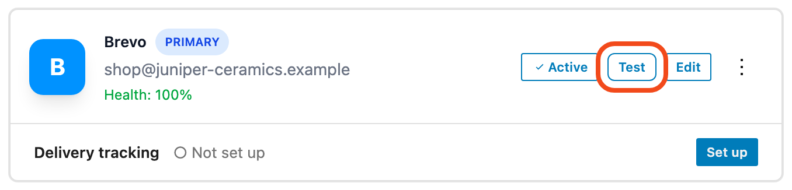
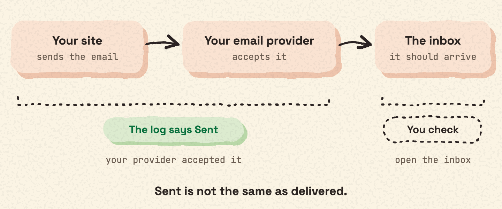

## When to send one

The setup wizard ends with a test email. After that, you can send a test email at any time to check your connection. A good time is right after you add a connection or change its details.

To add, edit or test a connection, go to **Mail Ops › Connections**.

## What the result means

| Status | What it means |
| --- | --- |
| Sent | Your provider accepted the email. |
| Failed | Sending did not work. The email log shows the error message. |

> [!TIP] Sent is not the same as delivered
> "Sent" means your provider accepted the email. Check the inbox you sent the test to, to see that it arrived.

To read error messages, see [Read the email log](log.md).

## Where the test email goes

A test email goes to the email service of your connection, like any other email. See [The 27 email services](services.md) for what is sent to each service.
