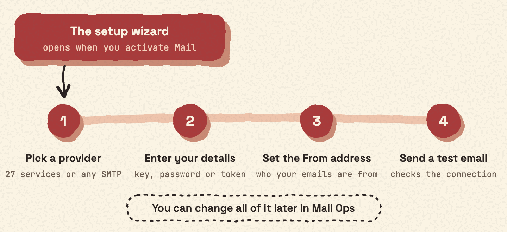

## When it opens

The setup wizard opens after you activate Impressive Mail. If you have not installed the plugin yet, start with [Install Impressive Mail](install.md).

## What it helps you do

1. Pick a provider.
2. Enter your details.
3. Set the From address.
4. Send a test email.

## Before you start

Have the login details for your email service ready. Depending on the service, that is a username and password, an API key, or an access token.

- Many providers can send through their HTTP API when you enter an API key. Without a key, they send through SMTP.
- Gmail and Microsoft 365 connect through SMTP. For Gmail, you use an App Password. See [Does it work with Gmail?](faq.md#does-it-work-with-gmail)

Not sure your provider is supported? See [The 27 email services](services.md). You can also use any other SMTP server.

## After the wizard

You can change everything later in the **Mail Ops** menu. To add, edit or test a connection, go to **Mail Ops › Connections**. See [Add a connection](connections.md).
